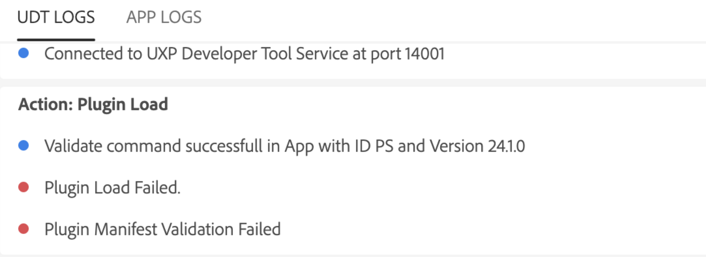

# UXP Hybrid plugin SDK

## Introduction

A UXP plugin can provide extensive functionality using JavaScript, HTML, and CSS. However, situations can arise in which the UXP runtime cannot address specific programming needs. To address such circumstances and enhance the plugin capabilities, UXP is introducing a new extensibility technology called the **UXP Hybrid plugin**.

## Table of contents

- [Introduction](#introduction)
- [Supported host applications](#supported-host-applications)
- [What is a UXP Hybrid plugin?](#what-is-a-uxp-hybrid-plugin)
- [Use-Cases](#use-cases)
- [What is included in the UXP Hybrid SDK](#what-is-included-in-the-uxp-hybrid-sdk)
  - [api](#api)
  - [utilities](#utilities)
  - [templates](#templates)
- [How to build a UXP Hybrid plugin?](#how-to-build-a-uxp-hybrid-plugin)
  - [Create uxpaddons](#create-uxpaddons)
  - [Using `uxpaddon` in your JavaScript code](#using-uxpaddon-in-your-javascript-code)
  - [`manifest.json` changes](#manifestjson-changes)
- [How to package a UXP Hybrid plugin?](#how-to-package-a-uxp-hybrid-plugin)
- [Additional information](#additional-information)
- [Host-application C++ SDK vs. UXP Hybrid plugin SDK](#host-application-c-sdk-vs-uxp-hybrid-plugin-sdk)
  - [Photoshop-specific integration](#photoshop-specific-integration)
- [UXP Documentation Links](#uxp-documentation-links)

## Supported host applications

Hybrid plugins run only in host applications that ship a compatible UXP runtime. Set `host.app` and `host.minVersion` in `manifest.json` to match the product you target.

| Application  | `host.app`    | Minimum version |
| ------------ | ------------- | --------------- |
| Photoshop    | `PS`          | 24.2            |
| Premiere Pro | `premierepro` | 26.2            |

## What is a UXP Hybrid plugin?

A **UXP Hybrid plugin** is a UXP plugin that can load dynamically-linked shared objects written in C++. They are conceptually similar to [**C++ addons**](https://nodejs.org/docs/latest-v16.x/api/addons.html) supported in **Node.js v16.13.0**. These dynamically-linked libraries are loaded at runtime via the **require()** function, just like any other JavaScript module.

```
const addon = require("sample.uxpaddon");
```

## Use-Cases

- Build an image manipulation plugin where most of the logic and user interface are written in UXP, but the manipulation code is written in high-performance C++. For example, a plugin that embeds an invisible watermark.
- An algorithm that has performance issues running in JavaScript.
- A plugin that needs to leverage code available only in C++.

## What is included in the UXP Hybrid SDK

The UXP Hybrid plugin SDK provides headers consisting of APIs and data types required to generate dynamically-linked shared objects written in C++, referred to as 'uxpaddons'. The uxpaddon provides an interface between JavaScript and C++ libraries.

The APIs of the UXP Hybrid plugin SDK are very similar to the Node API. For any API in UXP Hybrid plugin SDK with a similar name as **Node API**, please refer to [Node API v16.13.0 documentation](https://nodejs.org/docs/latest-v16.x/api/n-api.html).

This SDK consists of two folders: `src/api` and `src/utilities`.

### api

**`UxpAddonTypes.h`**
This includes all the addon types that the UXP Hybrid plugin supports. It exposes fundamental datatypes as abstractions that are consumed by the various APIs. These APIs should be treated as opaque; introspection is only possible via other UXP Hybrid plugin SDK-API calls.

**`UxpAddonShared.h`**
This includes all the addon APIs that the UXP Hybrid plugin can use. As mentioned above, these are very similar to the Node API. Refer to the Node API documentation.

### utilities

This consists of the basic utility classes that provide common, often reused functions. **`UxpAddon.h`** consists of the `UXP_ADDON_INIT` and `UXP_ADDON_TERMINATE` macros, with which the initialization and termination routine of the addon can be specified, respectively

### templates

[template-dev](template/template-dev) contains the source code you can use to write your plugin.

[template-plugin](template/template-plugin) is provided as an example of a compiled UXP Hybrid plugin. Observe the folder structure and the executable `.uxpaddon` files. You can directly load this into UDT to run the plugin.

## How to build a UXP Hybrid plugin?

### Create uxpaddons

- Create a new Xcode/Visual Studio project with the target as a dynamic library
- Include the UXP Hybrid plugin SDK API path in your project.

#### Write your C++ logic

(See [module.cpp](template/template-dev/src/module.cpp) for reference )

- Include the `"UxpAddon.h"` header file. This is very similar to including the `"napi.h"` header file while creating C++ addons in Node.js.
- Implement an addon initialization function (say, `init`) to register all your addon functions and pass it as `UXP_ADDON_INIT(init)`.
- Implement an addon termination function (say, `terminate`) to specify the termination routine and pass it as `UXP_ADDON_TERMINATE(terminate)`.
- Addon APIs defined in the structure `addon_apis` in `"UxpAddonShared.h"` can be invoked as `UxpAddonApis.uxp_addon_***()`.

Generate the dynamic libraries (`.dylib/.dll`) and change the extension file type to `.uxpaddon` replacing `.dylib/.dll`.

### Using `uxpaddon` in your JavaScript code:

Access the methods/properties injected by the addon in the JavaScript context.

```
const addon = require("sample-uxp-addon.uxpaddon");
let functionResult = addon.first_function();
```

### `manifest.json` changes

- Use Manifest version 6 or above
- Set the minimum host application version using the [Supported host applications](#supported-host-applications) table (`host.app` and `host.minVersion`).
- In Photoshop, use `"apiVersion: 2"`
- Provide the name of the `uxpaddon` using the `"addon"` field:
  ```json
  "addon": {
      "name": "sample-uxp-addon.uxpaddon"
  }
  ```
- Add the permission to load the addon:
  ```json
  "requiredPermissions": {
      "enableAddon" : true
  }
  ```

Your final `manifest.json` should have the following properties:

```
"manifestVersion": 6,
"host": {
  "app": "PS",                 // or "premierepro"
  "minVersion": "24.2.0",
  "data": { "apiVersion": 2 }  // only for Photoshop
},
"addon": {
  "name": "sample-uxp-addon.uxpaddon"
},
"requiredPermissions": {
  "enableAddon": true
}
```

## How to package a UXP Hybrid plugin?

Place the `uxpaddons` in a folder structure illustrated below:

```txt
📁 root directory
├── 📄 manifest.json
├── 📄 main.js
├── 📁 mac
│   ├── 📁 x64
│   │   └── ⚙️ sample-uxp-addon.uxpaddon (dylib)
│   └── 📁 arm64
│       └── ⚙️ sample-uxp-addon.uxpaddon (dylib)
└── 📁 win
    └── 📁 x64
        └── ⚙️ sample-uxp-addon.uxpaddon (dll)
```

Otherwise, the plugin load will fail with the rejection reason as _"Plugin Manifest Validation Failed"_ in the UDT ([UXP Developer Tool](https://www.adobe.com/download/uxp-developer-tools)) LOGS tab.



With UDT, you can build and test your plugin locally. However, before publishing to the marketplace, make sure to test your plugin on all architectures (Mac arm64, Mac x64, and Windows x64). It is possible to build and install a Hybrid plugin that only supports a subset of architectures for local development or independent distribution, but Adobe Marketplace submission requires full coverage.

## Additional information

Using the addon API, you can have two-way communication between JavaScript and C++ code; the Template plugin illustrates how to allow JavaScript to call C++ functions.

It is important to consider thread contexts when working with addon modules. Initialization and termination routines are invoked on the host application's main thread. Any call from JavaScript is invoked on a thread dedicated to JavaScript processing. The scripting thread is never the main thread. It is important to _only_ execute JavaScript-related functions, such as `uxp_addon_open_handle_scope`, from the scripting thread.

> JavaScript handles (`addon_env`, `addon_value`, promises, handle scopes) are **only valid on the JavaScript scripting thread**. The main thread must not use them directly — use `uxp_addon_schedule_on_main_queue` and `uxp_addon_schedule_on_javascript_queue` to move work between threads. Misuse will crash the host application or produce invalid-context errors.

This means that a plugin may need to schedule an operation from the scripting thread to be performed on the main thread at some later time. When the main thread task completes, it may want to schedule the result back to the JavaScript thread. This is an example of an asynchronous operation, and such operations are exposed to JavaScript using promises. The following pseudo-code describes the steps involved in implementing an asynchronous operation:

```C++
/// Native function invoked from JavaScript:
addon_value MyAsyncEcho(addon_env env, addon_callback_info info) {
    // extract arguments.
    addon_value = ...;

    // Values of type addon_value are transient and cannot be used past
    // returning from MyAsyncEcho
    // We therefore have to convert to standard types
    std::string myArg = ExtractString((env, addon_value);

    // Create a deferred value for the result. This will present as a promise in
    // JavaScript
    addon_deferred promiseValue = nullptr;
    addon_value deferred = nullptr;
    apis.uxp_addon_create_promise(env, &deferred, &promiseValue);

   // Schedule an operation on the main thread.
   // Make sure to store the env and the addon_deferred value in task
   // specific storage
   apis.uxp_addon_schedule_on_main_queue(env, MainThreadTask, ...);
   return deferred;
}

// Main Thread function
void MainThreadTask(...) {
    // Perform your task.

    // Schedule a result task to run on the scripting thread
    // Make sure to store the env and the addon_deferred value in task
    // specific storage
    apis.uxp_addon_schedule_on_javascript_queue(env, ScriptThreadTask, ...);
}

// Script Thread function
void ScriptThreadTask(...) {
    // Open a script result scope
    apis.uxp_addon_open_handle_scope(env, &scope);

    // resolve or reject the JavaScript promise
    addon_value resultValue = nullptr;
    apis.uxp_addon_resolve_deferred(env, deferred, resultValue);
    uxp_addon_close_handle_scope(env, scope);
}
```

The template project includes a sample implementation of an asynchronous operation (see `MyAsyncEcho` in [module.cpp](/template/template-dev/src/module.cpp) ).

## Host-application C++ SDK vs. UXP Hybrid plugin SDK

If you are familiar with building plugins using a host-application C++ SDK, the table below highlights how UXP Hybrid plugins compare.

| Aspect                    | C++ SDK plug-ins (native)          | UXP Hybrid plug-ins                                                         |
| ------------------------- | ---------------------------------- | --------------------------------------------------------------------------- |
| **API access**            | Full access to low-level host APIs | High-level UXP + host APIs                                                  |
| **UI framework**          | Custom platform-specific UI        | Modern UI via HTML/CSS + Spectrum Web Components                            |
| **Cross-platform**        | Requires separate builds per OS    | Cross-platform (JS layer); native hybrid layer still needs per-OS builds    |
| **Security model**        | Deeper system access               | Sandboxed environment with explicit permissions; relaxed file system access |
| **Host feature coverage** | Complete                           | Growing, but it varies by host                                              |

### Photoshop-specific integration

Photoshop extends the general model above with two additional capabilities:

- **C++ SDK ↔ UXP messaging:** A traditional Photoshop C++ plug-in can exchange messages with a UXP plug-in (and vice-versa) through the `PIUXPSuite`, letting legacy plug-ins coexist and communicate with modern UXP extensions without a full rewrite.
- **Photoshop C++ SDK suites from a hybrid add-on:** A UXP Hybrid add-on loaded in Photoshop can export a special entry point that Photoshop invokes on load, giving the add-on access to any Photoshop C++ API suite (e.g. color space conversion, action descriptors) directly from native code.

## UXP Documentation Links

- [Photoshop Hybrid plugins](https://developer.adobe.com/photoshop/uxp/2022/guides/hybrid-plugins)
- [Premiere Hybrid plugins](https://developer.adobe.com/premiere-pro/uxp/plugins/hybrid-plugins/)
